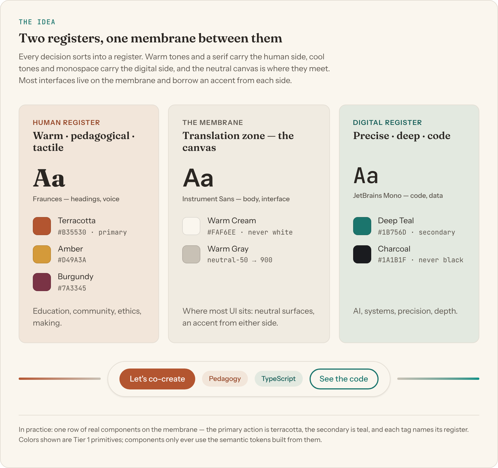
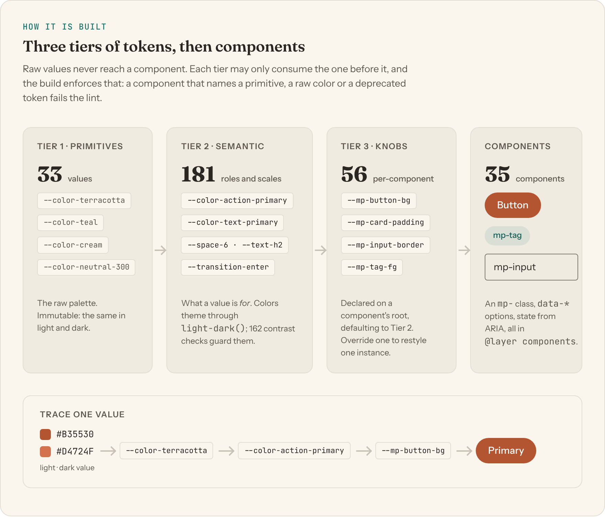
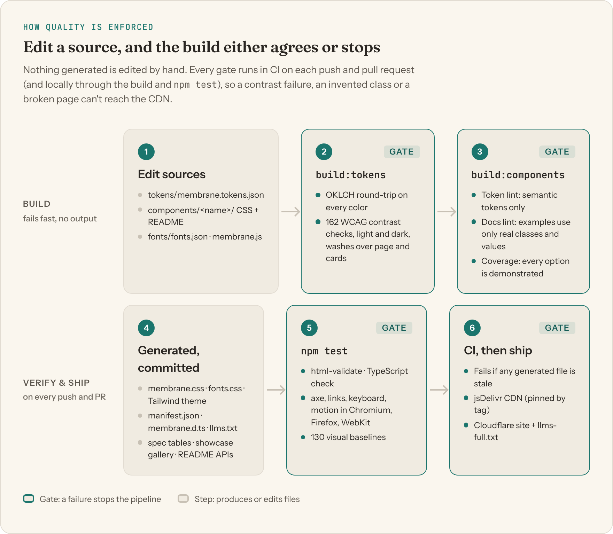

<p align="center">
  
  
  
  
  
  
  
</p>

<br>

<p align="center">
  
</p>

<h1 align="center">
  <strong>The Membrane Palette</strong>
</h1>

<p align="center">
  <em>A token-based design system and component library where human warmth meets digital precision.</em>
</p>

<br>

<p align="center">
  <code>#B35530</code> Terracotta &nbsp;&bull;&nbsp;
  <code>#1B756D</code> Deep Teal &nbsp;&bull;&nbsp;
  <code>#FAF6EE</code> Warm Cream &nbsp;&bull;&nbsp;
  <code>#1A1B1F</code> Rich Charcoal
</p>

<p align="center">
  <a href="https://membrane-palette.dcesares.dev/"><strong>Live Showcase</strong></a> &nbsp;•&nbsp;
  <a href="#quick-start">Quick Start</a> &nbsp;•&nbsp;
  <a href="#components">Components</a> &nbsp;•&nbsp;
  <a href="#for-ai-agents">For AI Agents</a> &nbsp;•&nbsp;
  <a href="#token-architecture">Architecture</a> &nbsp;•&nbsp;
  <a href="docs/AUDIT-2026-10.md">Assessment report</a> &nbsp;•&nbsp;
  <a href="#deployment">Deployment</a> &nbsp;•&nbsp;
  <a href="#contributing">Contributing</a>
</p>

<br>

---

<br>

## The Concept

Every design system makes trade-offs. This one makes a specific bet: **the best interfaces hold the human and the digital simultaneously** — warm without being casual, precise without being cold.

The **Membrane Palette** is organized around a central metaphor — the translation zone between registers:

<picture>
  <source media="(prefers-color-scheme: dark)" srcset="docs/figures/idcesares-figure-membrane-dark.png">
  
</picture>

Steel Blue exists only as a data color (`--color-chart-5`); it never appears in UI chrome.

When a design element relates to the human side — education, community, ethics — it gravitates toward warm tones. When it relates to the digital side — code, AI, systems — it gravitates toward cool tones. When it bridges both (which is most of the time), it uses the neutral membrane colors with accents from either register.

<br>

## What This Is

A **design system with a framework-free CSS component library**. Link one stylesheet, write semantic HTML, and you get the brand: tokens, typography, dark mode, page defaults, self-hosted fonts and 35 accessible components — or use the same tokens from Tailwind, TypeScript, a charting library or a native app.

| File | Purpose |
|------|---------|
| [`membrane.css`](membrane.css) | **The one link.** Generated: fonts + tokens + base + all components. |
| [`components/`](components/) | **Component library.** One folder per component: `<name>.css` (source) + `README.md` (docs, examples, generated API). Bundled into `components/membrane-components.css`. |
| [`components/manifest.json`](components/manifest.json) | **Machine-readable API.** Every component's classes, allowed `data-*` values, states, knobs, tokens and HTML examples. Generated. |
| [`components/membrane.d.ts`](components/membrane.d.ts) | **TypeScript types.** Generated from the manifest: class names, each component's allowed options, public tokens and knobs. Types only, for React/Vue/Svelte/Astro. |
| [`components/membrane.js`](components/membrane.js) | **Behaviors** (~5 KB gzipped): needed by Tabs, Menu, Combobox and Toast; adds tooltip Escape-dismiss and dialog invoker fallbacks. |
| [`tokens/membrane.tokens.json`](tokens/membrane.tokens.json) | **Single source of truth for values.** DTCG-flavored JSON. Edit this; never edit the CSS. |
| [`tokens/design-tokens.css`](tokens/design-tokens.css) | **Generated.** Custom properties — Tier 1 primitives and Tier 2 semantic tokens (Tier 3 knobs live in the component CSS), OKLCH colors, `light-dark()`, `@layer tokens`. |
| [`tokens/base.css`](tokens/base.css) | **Generated.** Page defaults (canvas, text, font, `box-sizing`, all zero-specificity), `::selection`, focus ring, reduced motion, `.type-*` composites. |
| [`tokens/membrane-tailwind.css`](tokens/membrane-tailwind.css) | **Generated.** Tailwind v4 theme: only `mp-` utilities mapped to the tokens; default palette removed. |
| [`tokens/tokens.resolved.json`](tokens/tokens.resolved.json) | **Generated.** Every token's light and dark value as plain hex, for charting libraries, native apps and tools. |
| [`fonts/`](fonts/) | **Self-hosted fonts** (SIL OFL): Fraunces, Instrument Sans, JetBrains Mono as variable woff2, plus `fonts.css` (generated from `fonts.json`, already inside `membrane.css`). |
| [`brand/`](brand/) | **Brand marks** as outlined SVG: wordmark, compact, `dc` monogram, app icons. |
| [`DESIGN-SYSTEM.md`](DESIGN-SYSTEM.md) | **Specification.** Principles, color, type, spacing, components, dark mode, accessibility. |
| [`showcase/index.html`](showcase/index.html) | **Living reference.** Every component and token, rendered — [live](https://membrane-palette.dcesares.dev/). |
| [`examples/`](examples/) | **Pattern pages** to copy — [starter](examples/starter.html), [article](examples/article.html), [dashboard](examples/dashboard.html) — linted against the library. |
| [`tests/`](tests/) | **Tests** — in Chromium, Firefox and WebKit: axe-core in both themes, overflow, link integrity, keyboard and motion behavior; Chromium visual baselines of every component gallery example; a TypeScript check of the generated types (`npm test`, after an html-validate pass). |
| [`llms.txt`](llms.txt) | **Agent index** ([llmstxt.org](https://llmstxt.org)) with the house rules. |

<br>

## Components

| Category | Components |
|---|---|
| Layout | [Layout](components/layout/README.md) — container, stack, cluster, grid, section, surface · [Text](components/text/README.md) · [Prose](components/prose/README.md) |
| Actions | [Button](components/button/README.md) · [Link](components/link/README.md) |
| Forms | [Field](components/field/README.md) · [Input](components/input/README.md) · [Combobox](components/combobox/README.md)<sup>β</sup> · [Choice](components/choice/README.md) · [Switch](components/switch/README.md) |
| Content | [Card](components/card/README.md) · [Tag](components/tag/README.md) · [Badge](components/badge/README.md) · [Avatar](components/avatar/README.md) · [Quote](components/quote/README.md) · [Code](components/code/README.md) · [Divider](components/divider/README.md) · [Table](components/table/README.md) · [Stat](components/stat/README.md) · [Chart](components/chart/README.md)<sup>β</sup> · [Icon](components/icon/README.md) |
| Feedback | [Alert](components/alert/README.md) · [Progress](components/progress/README.md) · [Skeleton](components/skeleton/README.md) · [Empty state](components/empty-state/README.md) · [Toast](components/toast/README.md)<sup>β</sup> · [Tooltip](components/tooltip/README.md) · [Dialog](components/dialog/README.md) |
| Navigation | [Navbar](components/navbar/README.md) · [Breadcrumb](components/breadcrumb/README.md) · [Tabs](components/tabs/README.md) · [Accordion](components/accordion/README.md) · [Pagination](components/pagination/README.md) · [Steps](components/steps/README.md) · [Menu](components/menu/README.md)<sup>β</sup> |

<sup>β</sup> Beta: newer components whose API may still grow. Removals and renames still follow the deprecation policy (status is in each README's frontmatter and in the manifest).

**The API in one paragraph.** A class names the component (`mp-button`), a BEM element names a part (`mp-card__title`), a `data-*` attribute picks an option from a closed set (`data-variant="secondary"`, `data-size="sm"`, `data-tone="human"`), and **native attributes and ARIA drive state** (`disabled`, `aria-invalid="true"`, `aria-current="page"`, `aria-busy="true"`) — so what you see and what a screen reader hears can't disagree.

```html
<form class="mp-stack" data-gap="5">
  <div class="mp-field">
    <label class="mp-field__label" for="email">Email</label>
    <input class="mp-input" id="email" type="email" aria-describedby="email-hint">
    <p class="mp-field__hint" id="email-hint">We'll only send the workshop materials.</p>
  </div>
  <label class="mp-choice"><input class="mp-switch" type="checkbox" role="switch"> Remind me a day before</label>
  <div class="mp-cluster">
    <button class="mp-button" type="submit">Let's co-create</button>
    <button class="mp-button" type="button" data-variant="ghost">Maybe later</button>
  </div>
</form>
```

Every component lives in `@layer components`, so any CSS you write wins without `!important`. To restyle one instance, override its `--mp-<component>-*` knobs (listed in each README's API section).

<br>

## For AI Agents

This repo is written to be machine-consumable, not just human-readable. If you're an agent generating UI with this system:

| Read this | For |
|---|---|
| [`llms.txt`](llms.txt) | The index and the rules, in one short file. The live site also serves `llms-full.txt` (every component doc inlined). |
| [`components/manifest.json`](components/manifest.json) | The exact API: valid classes, the only allowed `data-*` values, styled states, component tokens, and copyable HTML per component. |
| [`components/membrane.d.ts`](components/membrane.d.ts) | The same API as TypeScript types, when generating framework code. |
| [`examples/starter.html`](examples/starter.html) | A complete, correct page to start from. |
| [`DESIGN-SYSTEM.md` §11.4](DESIGN-SYSTEM.md#114-ai-agent-configuration) | A copy-pasteable visual + UI + voice constraint block. |
| [`BRAND-VOICE.md`](BRAND-VOICE.md) | Tone and vocabulary for any copy you write alongside the UI. |
| [`CLAUDE.md`](CLAUDE.md) / [`AGENTS.md`](AGENTS.md) | Operating instructions for agents *changing this repo* (identical content). |

Everything an agent reads is **generated from the source and linted**: the build fails if a README example uses a class, attribute value or token the CSS doesn't implement, so the docs can't teach a model something that doesn't exist.

**The one rule that matters most when editing this repo:** `tokens/membrane.tokens.json` and `components/<name>/<name>.css` are sources; every other CSS file, the manifest, `llms.txt` and the marked regions of the READMEs, spec and showcase are build output. CI fails if they don't match a fresh `npm run build:system`.

<br>

## Quick Start

### Option A — CDN (jsDelivr, recommended)

```html
<!-- Everything: tokens + base + components -->
<link rel="stylesheet"
  href="https://cdn.jsdelivr.net/gh/idcesares/The-Membrane-Palette/membrane.css">

<!-- Needed for Tabs, Menu, Combobox and Toast; adds tooltip Escape and dialog fallbacks -->
<script src="https://cdn.jsdelivr.net/gh/idcesares/The-Membrane-Palette/components/membrane.js" defer></script>

```

The fonts come with it: `membrane.css` declares self-hosted Fraunces, Instrument Sans and JetBrains Mono (variable, latin + latin-ext, `font-display: swap`) with size-matched fallbacks, so there is no Google Fonts link to add and almost no layout shift while they load. To start downloading the body font sooner, preload it: `<link rel="preload" href="…/fonts/instrument-sans-latin-wght-normal.woff2" as="font" type="font/woff2" crossorigin>`.

Only want the tokens? Link `tokens/design-tokens.css` (and optionally `tokens/base.css`) instead — the component bundle is a separate file, `components/membrane-components.css`, and the fonts are `fonts/fonts.css`.

> **Note:** Do not use `raw.githubusercontent.com` — GitHub serves raw files as `text/plain` and browsers reject them as stylesheets. These URLs have no version pin, so they serve the latest commit on the default branch; pin to a release tag once one exists if you need a stable reference.

### Option B — Tailwind CSS v4

```css
@import "tailwindcss";
@import "./membrane-tailwind.css";   /* from tokens/ */
```

Load `tokens/design-tokens.css` and `fonts/fonts.css` on the page too (the utilities reference the token custom properties, and `font-mp-*` needs the font faces). Tailwind's default palette is removed, so only on-brand utilities exist:

```html
<button class="bg-mp-primary hover:bg-mp-primary-hover text-mp-on-accent rounded-full px-6 py-2">Let's co-create</button>
<article class="bg-mp-surface-2 text-mp-fg border border-mp-border rounded-mp-lg shadow-mp-raised p-6">
  <h3 class="font-mp-display text-mp-h3">…</h3>
</article>
```

`bg-blue-500`, `text-white` or `rounded-md` simply don't compile, which keeps hand-written and agent-written utility code on-brand. Spacing (`p-4` = `--space-4`) and breakpoints already match.

### Using it from a framework

The library is CSS plus attributes, so it works unchanged in React, Vue, Svelte or Astro. Write the same classes and `data-*` options. For type safety, import the generated types:

```tsx
import type { MpAttrs } from "…/components/membrane.d.ts";

const save: MpAttrs<"button"> = { "data-variant": "secondary", "data-size": "sm" };
<button className="mp-button" {...save}>Save draft</button>
// { "data-variant": "primary" } fails to compile: the CSS has no such option.
```

Boolean options (`data-icon-only`, `data-full-width`…) are presence attributes: pass `true` to set them and leave them out to unset them.

### Option C — Copy the files

Copy `membrane.css` **and the `fonts/` folder next to it**: the stylesheet loads its fonts from `fonts/*.woff2`, and the folder's `OFL-*.txt` files are the font licenses, which must travel with the fonts. Add `components/membrane.js` if you use Tabs, Menu, Combobox or Toast. Regenerate with `npm run build:system` when you fork and modify the sources.

npm distribution isn't set up for now — the CDN link above is the supported integration path until that changes.

<br>

## Running Locally

```bash
git clone https://github.com/idcesares/The-Membrane-Palette.git
cd The-Membrane-Palette
npm install
npm run dev          # builds everything, then serves the showcase at localhost:3456
```

To run the checks (html-validate, the TypeScript check, then in three browser engines: axe-core in both themes, phone overflow, links, keyboard, motion under full/reduced/touch; plus Chromium visual baselines):

```bash
npx playwright install --with-deps chromium firefox webkit   # once
npm test                          # builds, serves dist/, runs tests/*.spec.mjs
npx playwright test tests/visual.spec.mjs --update-snapshots   # after an intended visual change
```

To modify tokens or components and rebuild:

```bash
# Edit tokens/membrane.tokens.json and/or components/<name>/*, then:
npm run build:tokens      # tokens CSS; aborts if any WCAG contrast pair fails
npm run build:components  # lints components + docs; writes bundles, manifest, llms.txt
npm run build:system      # both, in order
```

<br>

## Deployment

The showcase site is the only thing this repo deploys right now. Token distribution is the CDN link from [Quick Start](#quick-start) — there's no publish step to run.

```bash
npm run build     # regenerates everything, assembles dist/ (showcase, 404, _headers, assets/, tokens/, components/, examples/, fonts/, brand/, membrane.css, llms.txt, llms-full.txt, robots.txt, sitemap.xml and the Markdown docs)
npm run deploy    # builds, then `wrangler pages deploy` uploads dist/ to Cloudflare Pages
```

`dist/` is gitignored — it's rebuilt fresh on every deploy and every CI run, never committed. Live at [membrane-palette.dcesares.dev](https://membrane-palette.dcesares.dev/). Cutting a version (tag, pinned CDN URLs, deploy, smoke test) follows [`docs/RELEASING.md`](docs/RELEASING.md).

A token rename or removal is still a breaking change regardless of distribution channel: bump the version per [`CHANGELOG.md`](CHANGELOG.md)'s semantic conventions and add a migration note (see the [2.0.0 migration guide](CHANGELOG.md#migration-guide-1) for the shape that should take).

<br>

## Token Architecture

A **three-tier architecture**. Values live in `tokens/membrane.tokens.json`; components live in `components/`; everything else is generated.

<picture>
  <source media="(prefers-color-scheme: dark)" srcset="docs/figures/idcesares-figure-architecture-dark.png">
  
</picture>

How a change travels from source to CDN, and which checks can stop it:

<picture>
  <source media="(prefers-color-scheme: dark)" srcset="docs/figures/idcesares-figure-pipeline-dark.png">
  
</picture>

The full assessment behind v2.1, with findings and figures, is in [`docs/AUDIT-2026-10.md`](docs/AUDIT-2026-10.md).

Cascade layers are declared once, in order: `@layer tokens, base, components;` — unlayered consumer CSS beats all three.

### Tier 1 — Primitives (immutable)

Raw palette values. They never change between light and dark mode. Applications should avoid reaching into primitives directly.

```css
--color-terracotta:   oklch(55.96% 0.1327 41.1);   /* #B35530 */
--color-teal:         oklch(50.99% 0.0816 186.0);  /* #1B756D */
--color-cream:        oklch(97.40% 0.0114 84.6);   /* #FAF6EE */
--color-charcoal:     oklch(22.28% 0.0079 274.6);  /* #1A1B1F */
```

### Tier 2 — Semantics (theme-aware)

Intent-named tokens. **These are what applications consume.** Each carries its own `light-dark()` pair — primitives stay immutable.

```css
--color-action-primary:   light-dark(var(--color-terracotta), var(--color-terracotta-light));
--color-text-primary:     light-dark(var(--color-neutral-800), var(--color-neutral-100));
--color-bg-primary:       light-dark(var(--color-cream), var(--color-charcoal));
--color-focus:            light-dark(var(--color-teal), var(--color-teal-light));
```

Dark mode activates automatically via `color-scheme: light dark` on `:root`. Manual override:

```js
// Toggle
document.documentElement.setAttribute('data-theme', 'dark');   // force dark
document.documentElement.setAttribute('data-theme', 'light');  // force light
document.documentElement.removeAttribute('data-theme');         // follow OS
```

### Status & register color triads

Each status and each register comes as a fill, a text color and a wash. The text color is gate-checked at ≥4.5:1 on the page, on cards, **and on its own wash**, in both modes.

| Concept | Fill/icon | Text | Wash |
|---|---|---|---|
| Success | `--color-success` | `--color-success-text` | `--color-success-bg` |
| Warning | `--color-warning` | `--color-warning-text` | `--color-warning-bg` |
| Error | `--color-error` | `--color-error-text` | `--color-error-bg` |
| Info | `--color-info` | `--color-info-text` | `--color-info-bg` |
| Human register | `--color-action-primary` | `--color-human-text` | `--color-human-bg` |
| Digital register | `--color-action-secondary` | `--color-digital-text` | `--color-digital-bg` |

### Tier 3 — Component tokens

Each component declares `--mp-<component>-*` knobs that default to semantic tokens (`--mp-button-bg: var(--color-action-primary)`). Variants only reassign knobs, and you can too, per instance.

### Colors — 6 semantic families

```css
/* Primary registers */
--color-terracotta: oklch(…)   /* Human register — earth, hands, making */
--color-teal:       oklch(…)   /* Digital register — depth, ocean, code */

/* Canvas */
--color-cream:      oklch(…)   /* Light canvas. Never pure white. */
--color-charcoal:   oklch(…)   /* Dark canvas. Never pure black. */

/* Accents (spice — use sparingly) */
--color-amber:    oklch(…)     /* Builder energy. Fill/badge use only. */
--color-burgundy: oklch(…)     /* Heritage depth. */
--color-sage:     oklch(…)     /* Growth. Fill/icon; use --color-success-text for text. */
```

Plus a 10-step warm-tinted neutral scale (`--color-neutral-50` → `--color-neutral-900`), derived tints (`color-mix()`, mode-aware), ambient glow stop-colors, gradients, and code-block syntax tokens.

### Typography — 3 registers

| Font | Register | Usage |
|------|----------|-------|
| **Fraunces** (variable serif) | Human | Headings, display text |
| **Instrument Sans** | Digital | Body text, UI |
| **JetBrains Mono** | Builder | Code blocks, technical content |

Fluid type scale from `--text-xs` (0.75rem) to `--text-display` (clamp up to 3.75rem). Typography composite classes (`.type-display`, `.type-h1`…`.type-code`) ship in `tokens/base.css`.

### Spacing, Shadows, Motion

- **4px base unit** — `--space-1` (0.25rem) through `--space-32` (8rem)
- **Warm-tinted shadows** — each stop uses `light-dark()` for automatic dark-mode adaptation
- **Motion** — enter (`--transition-enter`, ease-out), exit (`--transition-exit`, faster, ease-in) and state (`--transition-state`) composites. Under `prefers-reduced-motion` transitions drop to 0ms and loaders pulse in place instead of moving (`--duration-loop` is kept)
- **Controls** — `--size-control-sm/md/lg` (36/44/52px); compact controls grow to 44px on touch screens
- **States** — explicit `-hover` fills that mix toward `--color-text-primary` (darker in light mode, lighter in dark mode, so label contrast always rises), translucent `--color-bg-hover` / `--color-bg-active` washes, and `--state-disabled-opacity`

<br>

## Design Principles

1. **Translation, Not Decoration** — Every element carries meaning. If it can't answer "what does this translate?", it doesn't belong.
2. **Warmth at the Foundation** — Default surfaces are warm, never clinical. Cream, not white. Charcoal, not black.
3. **Confident Restraint** — Authoritative without being loud. Generous whitespace, limited palette.
4. **The Maker's Mark** — Choices feel considered rather than generated. Optical adjustments, thoughtful type pairing.
5. **Brazilian Texture** — The warmth and materiality of Rio de Janeiro — earth tones, ocean tones, tropical green — globally legible but culturally grounded.

<br>

## Accessibility

- **Automated contrast gate:** the build verifies every foreground/background pair the UI depends on, in both modes, before writing CSS — text on every surface, button labels on resting *and hover* fills, register and status text on their washes (over both page and card surfaces), form-control boundaries and focus rings (WCAG 1.4.11), chart series, and every code syntax color. The full list is generated into `DESIGN-SYSTEM.md` §13.1. A failing pair aborts the build.
- **Component lint:** components may only use semantic tokens; docs may only show classes and values the CSS implements. CI runs both builds on every push and PR and fails if any generated file is stale.
- **State via ARIA:** component states are styled from `aria-*` and native attributes, so every visual state is also announced.
- All primary/secondary color pairings meet **WCAG AA** contrast requirements; primary text pairs target **AAA**.
- Focus states use a visible `2px solid` ring from `--focus-ring`, with a dedicated `--color-focus` semantic token that remaps to a higher-contrast value in dark mode. Form inputs keep the ring — the border color change alone is not the indicator.
- `prefers-reduced-motion: reduce` removes movement without freezing state: transitions become instant and loaders pulse in place. Hover effects only apply on devices that can hover.
- Interactive targets respect the 44px minimum via `--size-touch-target`.
- `prefers-contrast: more` raises secondary text to primary, darkens tertiary text, strengthens borders and input borders, and thickens the focus ring.
- Print styles: light scheme, site chrome hidden, and external link targets printed in prose.
- `forced-colors: active` strips decorative glows, and custom-drawn controls (checkbox, radio, switch, select) fall back to native rendering so Windows High Contrast mode keeps their state visible.
- Native elements first: `<dialog>`, `<details>`, `<progress>` provide focus management and keyboard support without script.

<br>

## Dark Mode

Fully automatic via `color-scheme: light dark` and `light-dark()` on every semantic token:

```css
/* Automatic — follows OS */
:root { color-scheme: light dark; }

/* Manual — attribute or class */
[data-theme="dark"]  { color-scheme: dark; }
[data-theme="light"] { color-scheme: light; }
.theme-dark          { color-scheme: dark; }   /* deprecated: removal in v3.0.0 */
```

Accent colors are paired per-token (primitives stay immutable; only semantic tokens theme). Shadows, glow effects, gradient endpoints, and derived tints all adapt automatically.

Because each token resolves `light-dark()` where it's used, `data-theme` works on **any subtree** — add `.mp-surface` so the subtree paints its own background:

```html
<section class="mp-section mp-surface" data-theme="dark">…</section>
```

<br>

## File Structure

```
The-Membrane-Palette/
├── membrane.css               ← Generated — the one stylesheet (fonts + tokens + base + components)
├── llms.txt                   ← Generated — agent index
├── tokens/
│   ├── membrane.tokens.json   ← Source of truth for values (edit this)
│   ├── design-tokens.css      ← Generated
│   ├── base.css               ← Generated
│   ├── membrane-tailwind.css  ← Generated — Tailwind v4 theme
│   └── tokens.resolved.json   ← Generated — light/dark values as hex
├── components/
│   ├── <name>/<name>.css      ← Component source (edit this)
│   ├── <name>/README.md       ← Docs + examples (edit; the API section is generated)
│   ├── membrane.js            ← Optional behaviors (hand-written)
│   ├── membrane-components.css← Generated bundle
│   ├── manifest.json          ← Generated machine-readable API
│   └── membrane.d.ts          ← Generated TypeScript types
├── fonts/                     ← Self-hosted woff2 + OFL licenses; fonts.json (source) → fonts.css (generated)
├── brand/                     ← Outlined brand marks (SVG)
├── examples/                  ← Pattern pages (starter, article, dashboard), linted
├── tests/                     ← Playwright (3 engines) + axe, visual baselines, type check
├── scripts/
│   ├── build-tokens.mjs       ← Token compiler (OKLCH + contrast gate)
│   ├── build-components.mjs   ← Component linter + bundler + manifest/docs generator
│   ├── build-cloudflare-pages.mjs ← Assembles dist/ for Pages deploy
│   ├── render-social-image.mjs ← Renders the og:image and touch icon (manual)
│   ├── measure-fonts.py       ← Measures fallback-font overrides (manual)
│   ├── render-brand-marks.py  ← Outlines the brand marks (manual)
│   └── render-doc-figures.mjs ← Renders the report figures (manual)
├── showcase/                  ← Living reference (index.html; gallery, tables generated), 404.html, _headers, assets/
├── docs/AUDIT-2026-10.md      ← The v2.1 assessment report (figures in docs/figures/, built from the system)
├── docs/RELEASING.md          ← Release checklist
├── .github/workflows/ci.yml   ← Gate + lint + freshness check on every push/PR
├── DESIGN-SYSTEM.md           ← Specification
├── BRAND-VOICE.md             ← Verbal identity guidelines
├── CHANGELOG.md               ← Version history
├── CLAUDE.md / AGENTS.md      ← Instructions for agents editing this repo (kept in sync)
└── dist/                      ← Generated, gitignored — Cloudflare Pages output
```

<br>

## Asset Naming Convention

All brand assets follow the pattern:

```
idcesares-{type}-{descriptor}-{variant}.{ext}
```

Examples: `idcesares-logo-wordmark-primary.svg`, `idcesares-photo-speaking-header.jpg`

<br>

## Contributing

1. **Tokens:** edit `tokens/membrane.tokens.json` — never the generated CSS. New color pairings get a `GATE` entry in `scripts/build-tokens.mjs`.
2. **Components:** edit `components/<name>/<name>.css` and its `README.md`. New components also go in `ORDER` in `scripts/build-components.mjs` (see [`DESIGN-SYSTEM.md` §6.5](DESIGN-SYSTEM.md#65-contributing-a-component)).
3. Run `npm run build:system` and commit the regenerated files alongside your change, then `npm test`. CI rejects PRs where generated files don't match a fresh build or a browser test fails. See [`CONTRIBUTING.md`](CONTRIBUTING.md) for the full checklist.
4. Retiring a token? Mark it `"$deprecated": "<reason>"` in the JSON instead of deleting it — the build emits an inline `/* @deprecated */` comment, a console summary, and refuses to let components use it (see [`DESIGN-SYSTEM.md` §15](DESIGN-SYSTEM.md#15-design-token-summary)).
5. Update [`DESIGN-SYSTEM.md`](DESIGN-SYSTEM.md) if the change affects the spec, and add an entry to [`CHANGELOG.md`](CHANGELOG.md) under `[Unreleased]` — lead with *why*, not just the diff.
6. Open a PR against `master`.

<br>

## License

[MIT](LICENSE) — Isaac D'Césares

<br>

---

<p align="center">
  <em>Built at the membrane between the human and the digital.</em><br>
  <em>Rio de Janeiro, 2026.</em>
</p>
