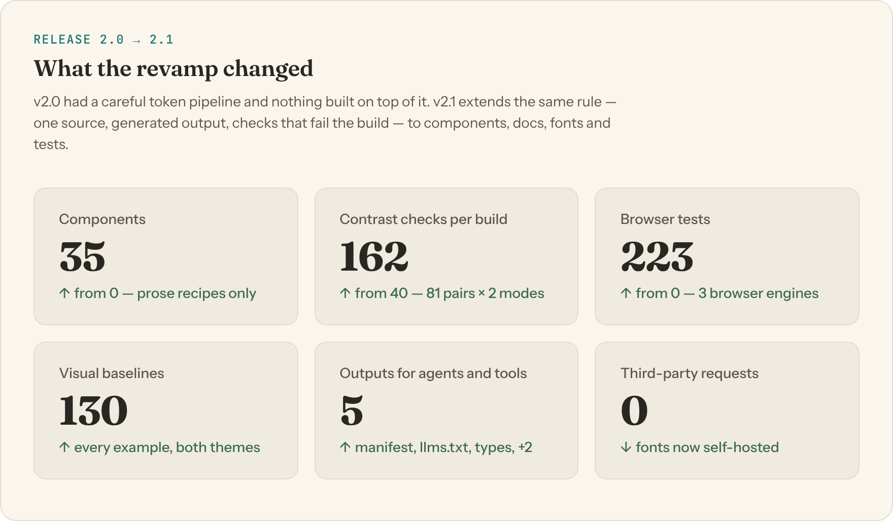
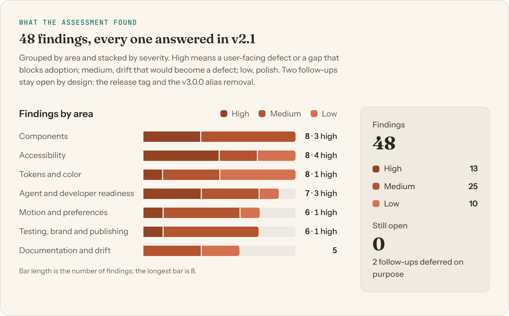

# The Membrane Palette — Design System Assessment

**October 2026 · v2.0.0 → v2.1.0** · Isaac D'Césares Design System

<picture>
  <source media="(prefers-color-scheme: dark)" srcset="figures/idcesares-figure-at-a-glance-dark.png">
  
</picture>

## Summary

The Membrane Palette began as a strong idea with a careful token pipeline: one DTCG source, OKLCH output, automatic dark mode through `light-dark()`, and a contrast gate that failed the build. Almost nothing was built on top of it. Components existed only as prose recipes in the specification, every product rebuilt them by hand, and the one implementation (the showcase) had already drifted from the recipes.

This assessment found **48 issues** across seven areas. **13 were high severity**: user-facing defects or gaps that blocked adoption. v2.1.0 answers every one. Its main move is to extend the pipeline's own discipline to everything else. Components, documentation, fonts, brand marks and tests now each have one source, generated output, and checks that stop the build when something is wrong.

The result is a framework-free library of 35 accessible components. It is readable by people and by agents, verified in three browser engines, and needs a single `<link>` to use. Two follow-ups remain open, both by choice: tagging the release, and removing deprecated aliases in v3.0.0.

**Contents**

1. [The idea](#1-the-idea)
2. [Where v2.0 stood](#2-where-v20-stood)
3. [How v2.1 is built](#3-how-v21-is-built)
4. [How quality is enforced](#4-how-quality-is-enforced)
5. [What the assessment found](#5-what-the-assessment-found)
6. [How the work unfolded](#6-how-the-work-unfolded)
7. [What is still open](#7-what-is-still-open)
8. [Method](#8-method)

---

## 1. The idea

<picture>
  <source media="(prefers-color-scheme: dark)" srcset="figures/idcesares-figure-membrane-dark.png">
  
</picture>

Every design decision sorts into a register:

- **Human register.** Warmth, teaching and making: terracotta, a serif, generous pacing.
- **Digital register.** Precision and depth: teal, monospace, exactness.
- **The membrane.** The neutral canvas where the two meet.

The test for any new decision is whether it reads as one of these, or as the translation between them. The assessment held every finding against that idea: a gap counted when it made the system harder to apply *consistently*, not merely when something was missing.

## 2. Where v2.0 stood

**What was already strong**

- A single token source (DTCG JSON) generating OKLCH custom properties, with Tier 1 primitives kept immutable.
- Dark mode by `light-dark()` on every semantic token, overridable per subtree.
- A WCAG contrast gate (20 pairs, both modes) that failed the build instead of warning.
- A clear brand voice and a specification with real rules, not mood boards.

**What was missing**

- **Components.** No component library: eight recipes in prose, re-implemented by every consumer.
- **Drift.** The only implementation had already diverged from the recipes, with different padding, weight and hover behavior.
- **Contrast coverage.** Form borders, code colors and washes on cards were never checked; three of them failed WCAG.
- **Agents.** Nothing machine-readable for them. An agent would invent plausible classes, and nothing would stop it.
- **Verification.** Accessibility and behavior were checked by hand once, then never again.

## 3. How v2.1 is built

<picture>
  <source media="(prefers-color-scheme: dark)" srcset="figures/idcesares-figure-architecture-dark.png">
  
</picture>

Values flow one way. A component never names a raw color or a primitive. It reads a Tier 3 knob, which defaults to a Tier 2 semantic token, which resolves through `light-dark()` to a Tier 1 primitive. Restyling one instance means overriding one knob, and rebranding means changing the source JSON.

The component API has one shape everywhere:

- a class names the component (`mp-button`);
- a part is a BEM element (`mp-card__title`);
- an option is a `data-*` attribute from a closed set (`data-variant="secondary"`);
- **state comes only from native attributes and ARIA** (`disabled`, `aria-invalid`, `aria-current`, `[open]`), so what a person sees and what a screen reader announces can't disagree.

Everything lives in `@layer components`, so any CSS a product writes wins without `!important`.

## 4. How quality is enforced

<picture>
  <source media="(prefers-color-scheme: dark)" srcset="figures/idcesares-figure-pipeline-dark.png">
  
</picture>

The principle is *right by construction*. The checks:

- **Contrast gate.** Every color pairing the interface depends on is measured in both modes before any CSS is written. That includes button labels on their hover fills, washes composited over cards, focus rings on every surface, chart series and code colors.
- **Docs lint.** A README example that uses a class, attribute or value the CSS doesn't implement fails the build.
- **Coverage lint.** An option the CSS implements but no example demonstrates also fails, so the showcase renders everything.
- **Generated docs.** The manifest, the TypeScript types and `llms.txt` are derived from the CSS, so the docs an agent reads cannot describe an API that doesn't exist.

## 5. What the assessment found

<picture>
  <source media="(prefers-color-scheme: dark)" srcset="figures/idcesares-figure-findings-dark.png">
  
</picture>

Severity:

- **High:** a user-facing defect, or a gap that blocks adoption.
- **Medium:** drift or friction that will become a defect.
- **Low:** polish.

Every finding below has a response in v2.1.0.

### Components

| # | Finding | Severity | v2.1 response |
|---|---|---|---|
| C1 | No component library. §6 of the spec described 8 components as prose recipes ("Padding: 0.875rem 2rem…"); consumers translated each into CSS by hand. | **High** | 35 components as plain CSS in `components/`, bundled into `membrane-components.css` and `membrane.css`. |
| C2 | The only implementation (showcase-local CSS) had already drifted from the recipes: button padding, font size, weight, secondary background and hover all differed. | **High** | Recipes retired. The showcase is built from the library, so there is one implementation. |
| C3 | Everyday components were missing: field, label, error, checkbox, radio, switch, select, textarea, alert, badge, avatar, table, tabs, accordion, dialog, tooltip, breadcrumb, progress, and layout primitives. | **High** | All added. |
| C4 | Button hover used `filter: brightness()`, which also brightened the label and could lower its contrast. | Medium | Explicit `-hover` tokens; the gate checks label contrast on the hover fill. |
| C5 | The clickable-card pattern was unspecified, inviting a whole card wrapped in `<a>` (its entire text becomes the link name). | Medium | `.mp-card__link` stretched link, with the focus ring on the card. |
| C6 | No convention for variants or states, so each consumer would invent their own (`.btn--outline`, `.is-active`…). | Medium | One API: `mp-` classes, `data-*` options from closed sets, state from ARIA and native attributes. |
| C7 | Components that need focus management were missing (menu, toast), as were pagination, steps, skeleton, empty state and icon sizing. | Medium | All added. `membrane.js` provides the behavior, and tests cover it. |
| C8 | No combobox: the one common form control still missing, so teams would reach for a third-party widget. | Medium | `mp-combobox`: WAI-ARIA list autocomplete with accent-insensitive filtering (it matters for pt-BR), a live result count and unavailable options. |

### Accessibility

| # | Finding | Severity | v2.1 response |
|---|---|---|---|
| A1 | Inputs used `--color-border-default` as their only boundary: about 1.3:1 on cream, failing WCAG 1.4.11 (3:1). | **High** | `--color-border-input`, gated at 3:1 or more on page, card and dialog surfaces, used by every control. |
| A2 | The showcase input removed its focus outline and relied on a 15%-alpha glow. | **High** | Every component keeps the 2px `--focus-ring`, inset where a scroll container would clip it. |
| A3 | `--code-comment` was 3.7:1 on `--code-bg`, and code colors weren't gated. | **High** | Lightened to 5.2:1; all six code colors gated. |
| A4 | Status and register washes were measured over the page only. axe found four failures where the same washes sit on cards. | **High** | The gate checks every wash over cards too; four text values adjusted. axe reports 0 violations on every page in both themes. |
| A5 | The spec's tag recipe (terracotta on `--color-terracotta-10`) was never contrast-checked. | Medium | Register pairs `--color-human-text`/`-bg` and `--color-digital-text`/`-bg`, gated. |
| A6 | Custom-drawn controls would lose their checked state in Windows High Contrast. | Medium | Checkbox, radio, switch and select hand back to native rendering under `forced-colors: active`. |
| A7 | The touch-target rule cited WCAG 2.5.5 as if it were AA (it is AAA; 2.5.8 AA is 24px), and small buttons had no touch fallback. | Low | Citation corrected. On coarse pointers every compact control grows to 44px: small buttons and inputs, pill tabs, menu items, combobox options and the toast close button. |
| A8 | The theme script ran late (a flash of the wrong theme) and ignored the OS preference; there was no skip link. | Low | Theme applied in `<head>`, following the OS by default; skip link on every page. |

### Tokens and color

| # | Finding | Severity | v2.1 response |
|---|---|---|---|
| T1 | No chart palette: §7.4 named three colors with no dark steps and no validation, so every chart library would pick its own. | **High** | `--color-chart-1…6`, searched and validated for color-blind separation and contrast in both modes, gate-checked, with a Chart component and rules in §7.4. |
| T2 | No surfaces for overlays, inverse elements (tooltip), or neutral hover and pressed states. | Medium | `--color-bg-elevated`, `--color-bg-inverse`/`--color-text-inverse`, `--color-bg-hover`/`--color-bg-active`. |
| T3 | Status colors had no background wash, so alerts would reach for primitives. | Medium | `--color-{success,warning,error,info}-bg` and `--color-info-text`. |
| T4 | The gate couldn't evaluate `color-mix()`, so any mixed token was unverifiable. | Medium | A `mix` token type, resolved in oklab by the build to match the browser. |
| T5 | `ease-in-out` and a 65ch measure were required by the spec but had no token. | Low | `--ease-in-out`, `--measure`. |
| T6 | No control-height scale; heights derived from padding. | Low | `--size-control-sm/md/lg` (36/44/52px). |
| T7 | Two names for one size (`--text-sm` = `--text-small`…) made generated code inconsistent. | Low | Aliases deprecated, kept until v3.0.0. |
| T8 | The register table named "Steel Blue" and "Slate", neither of which existed. | Low | Steel Blue became `--color-chart-5`; Slate removed (Charcoal is the anchor). |

### Agent and developer readiness

| # | Finding | Severity | v2.1 response |
|---|---|---|---|
| R1 | An agent had only prose: no list of valid classes, variants or states, so it would invent plausible ones. | **High** | `components/manifest.json`: classes, allowed values, states, knobs, tokens and examples for every component. |
| R2 | Nothing stopped docs from describing APIs that don't exist. | **High** | Docs lint. The API section of each README, and the manifest, are derived from the CSS. |
| R3 | No path for Tailwind, the most common thing agents write, and Tailwind's defaults collide with token names (`--radius-md`, `--text-sm`…). | **High** | A generated v4 theme: collisions reset, `mp-` utilities, default palette removed. |
| R4 | No entry point for language models. | Medium | `llms.txt` with the house rules, and `llms-full.txt` on the site. |
| R5 | No copyable full-page example. | Medium | `examples/starter.html`, then article and dashboard pattern pages, all linted like the README examples. |
| R6 | Every page had to hand-write body defaults (agents forget them), and muted copy needed inline styles. | Medium | Zero-specificity `:where()` page defaults in `base.css`, and a Text component. The pattern pages have no inline styles. |
| R7 | No typed API for framework users: an invalid option only showed up visually, at runtime. | Low | Generated `components/membrane.d.ts`; `npm run lint:types` proves bad values fail to compile. Wrapper components stay out of scope on purpose, because they would be a second API to keep in sync. |

### Motion and preferences

| # | Finding | Severity | v2.1 response |
|---|---|---|---|
| M1 | Reduced motion zeroed every duration, so spinners, progress bars and skeletons **froze**. A frozen spinner looks like a hung page. | **High** | `--duration-loop` is kept; loaders switch to an in-place pulse. The base safety net skips library classes. |
| M2 | §8.1 required ease-out entrances and quicker ease-in exits, but every overlay used one symmetric timing; toasts and the dialog backdrop vanished with no exit. | Medium | `--transition-enter` / `-exit` / `-state`: exit timing on the closed state, enter timing on the open state. |
| M3 | The spec said transforms were disabled under reduced motion; nothing did that. | Medium | Card lift, link nudge and press offset removed per component; §8 rewritten with a recipe for each component. |
| M4 | Hover effects ran on touch screens, leaving a button filled or a card lifted after a tap. | Medium | Hover-only effects gated on `@media (hover: hover)`, tested with touch emulation. |
| M5 | `prefers-contrast: more` ignored input borders and the focus ring, and nothing handled print. | Medium | Stronger borders and a thicker ring; a print layer with a light scheme, site chrome hidden and link targets printed. |
| M6 | Loop durations were literals, and two specified tokens (`--duration-slower`, `--ease-spring`) were never used. | Low | `--duration-loop`; spring drives the switch thumb; `slower` drives the theme crossfade. |

### Testing, brand and publishing

| # | Finding | Severity | v2.1 response |
|---|---|---|---|
| P1 | Accessibility and behavior were verified by hand, once. | **High** | Playwright and axe in CI. The first run caught two real bugs. |
| P2 | Tests ran in Chromium only, though popovers, anchoring and `::details-content` behave differently elsewhere. | Medium | Every suite runs in Chromium, Firefox and WebKit, except the visual baselines, which are Chromium-only by design (pixels differ per engine). |
| P3 | No visual regression: drift in padding, radius or color was invisible to axe and the lints. | Medium | 130 baselines covering every gallery example in both themes, recorded and compared in the official Playwright container so the font rasterizer is identical everywhere; a 2px change fails. |
| P4 | Fonts came from Google Fonts: a third-party request on every page and a visible jump on swap. | Medium | Self-hosted variable woff2 with metric-matched fallback faces; a test fails on any third-party request. |
| P5 | §10 specified the wordmark and monogram, but no files existed, so every use retyped the name. | Medium | Outlined SVGs in `brand/`: wordmark, compact and monogram, primary and reversed, plus app icons. |
| P6 | Publishing gaps: no social image, no 404 page, no security or CORS headers, no check for broken links or invalid HTML. | Medium | A social card rendered from the tokens; a 404 page; `_headers`; html-validate and link tests. They found a dead link and two labels screen readers ignored. |

### Documentation and drift

| # | Finding | Severity | v2.1 response |
|---|---|---|---|
| D1 | Spec tables were hand-maintained and stale (rgba literals for `color-mix()` tokens, hand-typed ratios, tokens that never existed). | Medium | The semantic-color and contrast tables are generated; stale text corrected. |
| D2 | CI only checked two token files for freshness; generated regions elsewhere could go stale. | Medium | CI fails on any uncommitted change after a fresh build. |
| D3 | No interface-writing or localization guidance; Portuguese expansion and number formats unaddressed. | Medium | `DESIGN-SYSTEM.md` §16: writing rules, pt-BR, `Intl` formatting, RTL. |
| D4 | The showcase's dark-mode demo hard-coded dark hex values instead of using the theme mechanism it demonstrated. | Low | Real `data-theme` subtrees (`.mp-surface`). |
| D5 | No contributor guide. | Low | `CONTRIBUTING.md`: which files are sources and which are generated, the build loop, and how to add a token or component. |

## 6. How the work unfolded

| Pass | Focus | What it added |
|---|---|---|
| 1 | **The library** | 25 components, one API convention, the docs and coverage lints, the manifest and `llms.txt`; the contrast gate extended to forms, washes on cards and code. |
| 2 | **Breadth** | Chart palette and component, Tailwind theme, resolved-token JSON, 9 more components, pattern pages, interface-writing and localization rules, the Playwright and axe suite. |
| 3 | **Motion and publishing** | Enter, exit and state timing; reduced motion that doesn't freeze; hover gating; print and high-contrast support; a 404 page, headers, social card, and HTML and link checks. |
| 4 | **Closing the list** | Self-hosted fonts, brand marks, the combobox, TypeScript types, Firefox and WebKit runs, visual baselines. |

## 7. What is still open

1. **Tag the release.** After merging, tag `v2.1.0` on `master` following [`RELEASING.md`](RELEASING.md), then switch the documented CDN URLs to `@2`. Until a tag exists, every jsDelivr link tracks the default branch. Update: git tag `v2.2.0` is that identifiable release, and public snippets now pin to `@2.2.0`.
2. **Remove the deprecated `--text-sm/base/md/lg/xl` aliases and the `.theme-dark` class in v3.0.0**, with a migration note. This is deliberately not done in 2.1: removal is a breaking change, and the aliases are promised until the next major version.

Worth watching after release:

- The brand marks were outlined programmatically from the font; a designer's pass on optical spacing (around `D’C`) is welcome.

## 8. Method

The assessment read the specification, tokens, showcase and build scripts, then tested each claim against the running system:

- **Contrast:** computed in OKLCH and sRGB, composited over each surface the UI uses.
- **Accessibility:** axe-core on every page in both themes.
- **Behavior:** keyboard paths walked in three browser engines.
- **Motion:** checked under full motion, reduced motion and touch emulation.
- **Charts:** palettes validated for color-blind separation before use.

A finding counted when it was observable (a measured ratio, a failing test, a contradiction between documents) rather than a matter of taste.

The figures in this report are built from the system itself, using `membrane.css`, its fonts and its components. `npm run render:figures` re-renders them from `docs/figures/src/`, in light and dark.
