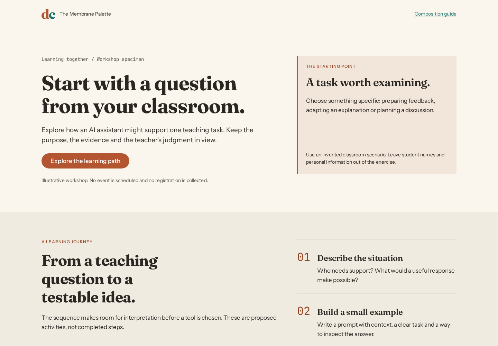
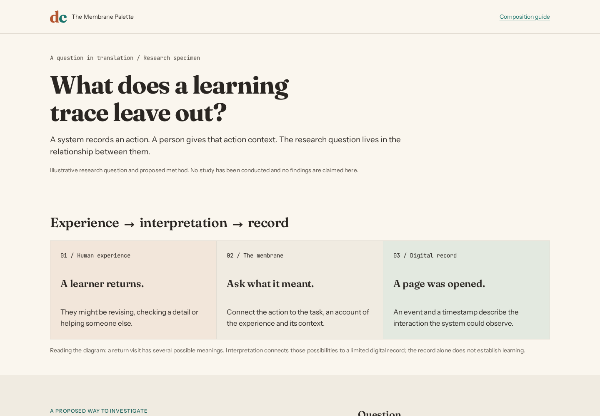
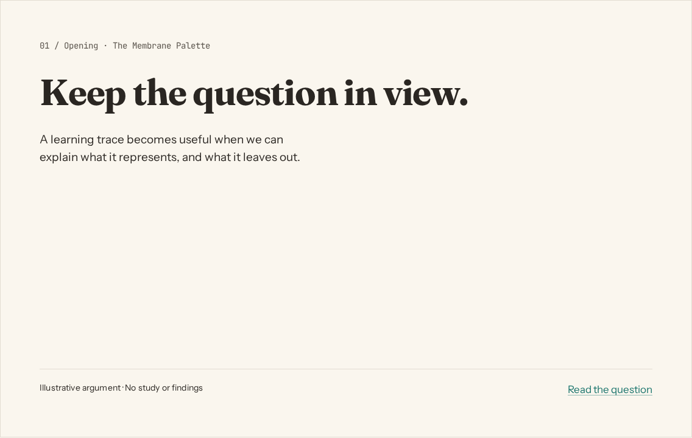

# Composing with Membrane

A complete piece needs an argument, a reading order and a reason for its visual choices. Components supply the vocabulary. Composition connects that vocabulary to what someone needs to understand or do.

Start with one sentence: **what should this person understand or be able to do after seeing the piece?** Choose the format and register from that sentence, then lay out the content.

## Choose the closest reference

| Intent | Start here | Composition move |
|---|---|---|
| Invite someone to learn | [Workshop](../../examples/workshop.html) | Human opening, a visible learning journey, practical preparation |
| Explain a research question | [Research explainer](../../examples/research-explainer.html) | Question, relationship diagram, method, limitation |
| Present an argument | [Presentation](../../examples/presentation.html) | Opening, question, translation, method, qualification, next step |
| Find and inspect a resource | [Resource explorer](../../examples/resource-explorer.html) | Search/filter, adaptive list/detail, bilingual content and recoverable sample states |
| Enter, review and confirm information | [Form journey](../../examples/form-journey.html) | Focused error summary, retained answers, review/edit, local failure/retry and confirmation |
| Give a piece visual character | [Visual language](../../examples/visual-language.html) | Original organic/structural motifs across a website opening, presentation cover and teaching card; editable SVG catalog |
| Publish an essay | [Article](../../examples/article.html) | Reading measure, progressive explanation, pull quote |
| Help someone inspect a system | [Dashboard](../../examples/dashboard.html) | Overview, comparisons, detail, action |
| Start a general page | [Starter](../../examples/starter.html) | Hero, related content, a clear next action |

The composition references contain **ILLUSTRATIVE** content. They are specimens, not an announced workshop, an actual study, a research finding or a portfolio claim. The explorer and form journey demonstrate local interactions and transmit no information. Replace sample copy with verified content before public use. The sample labels belong in screenshots and exports as well as in source. See [complete task patterns](../patterns/README.md) for behavior, adaptation and recovery, and [accessibility evidence](../accessibility/README.md) for coverage and outstanding manual checks.

## Choose the register by meaning

| Register | When it helps | How it appears |
|---|---|---|
| Human | Learning, participation, interpretation, consequences | Fraunces-led opening, human text/accent roles, generous pauses |
| Digital | Code, method, architecture, precision | Mono labels or code, digital text/accent roles, aligned detail |
| Membrane | Translation between an experience and a system | Warm neutral canvas, a visible relationship between the two registers |

Registers can meet on a single canvas. A research diagram can show a human question, a digital record and the interpretation connecting them. Labels and structure must explain the relationship even without color. Teal is also the link/action color; its presence alone does not make a section technical. Use semantic tokens for every role and follow the [visual specification](../../DESIGN-SYSTEM.md).

## Reusable composition moves

- **Opening + one support.** Lead with a meaningful heading and one explanation, image or next action. Let the heading establish the first read. Avoid adding equal-weight cards around it.
- **Question → translation → consequence.** Show what a person experiences, how a system represents it, and what that representation leaves out. The explainer demonstrates this with a labeled three-part diagram and a prose equivalent.
- **Journey + preparation.** Show an ordered learning path and a short preparation list. Use a plain ordered list for an agenda; reserve Steps and its current/completed states for real progress.
- **Evidence + qualification.** Keep method, source and limitation next to the claim. Put a comparison in a table or chart when the relationship matters; use a prominent number only when the number itself is the point.
- **Change of pace.** In a deck or long page, alternate open statements and structured detail. Repeat margins and type roles while varying the composition. An identical card grid on every canvas erases emphasis.
- **One next step.** End with a specific action or question. Use one primary terracotta action per view; references and secondary navigation can be ordinary links.

Compose with `.mp-container`, `.mp-stack`, `.mp-cluster`, `.mp-grid` and existing components first. Local CSS can arrange diagrams and page geometry using semantic tokens. Keep those rules in a page stylesheet, outside the component library; use component knobs when an instance needs adjustment. Do not invent new `mp-*` classes or attribute values.

`npm run build:components` checks every `examples/*.css` stylesheet against the same color/token contract as the library: no raw colors, unknown tokens, Tier 1 primitives or deprecated tokens. Local custom properties must use `--composition-*` (or existing `--mp-*` component knobs) and be declared in the same file. Design-token values remain defined only in the token JSON. Geometry such as aspect ratios and paper dimensions can be literal.

## Formats and density

These are starting points, not new token values or universal limits. The [creative latitude guide](creative-latitude.md) explains when to adapt them.

| Format | Starting composition | Adaptation rule |
|---|---|---|
| Web page | Fluid container; reading copy near the existing `--measure` (65ch) | Reflow diagrams and columns at narrow widths; preserve the DOM reading order |
| Editorial slide | 16:9; one idea; usually no more than 30 words | Cut copy before reducing type. The presentation reference prints as six landscape pages |
| Evidence or technical slide | Question + one diagram/table + method or source + qualification | More than 30 words is valid when needed for interpretation; inspect the full-size export and keep the first read obvious |
| Social card | Square 1080×1080 or portrait 1080×1350; one statement and one support | Test the image at phone-feed size; move supporting detail into the caption or another card |
| Poster or one-pager | A4/A3 portrait; opening, evidence, reading path, provenance | Inspect a print at its intended size. Keep captions and source text readable; split the piece before shrinking them |

For fixed canvases, choose type and margins relative to the available short side, then check the actual export. Web `clamp()` sizes depend on the viewport and do not automatically become a print scale. The presentation sets print-specific layout and type from existing tokens. Its screen view reflows vertically, rather than scaling a tiny slide to fit a phone.

The deck uses the named `membrane-slide` print page. Its landscape size, zero margins and hidden navigation apply only to the presentation; the workshop and research page retain the reader's selected paper size and their own header/footer.

For pt-BR, adapt the wording and set `lang="pt-BR"`; allow longer labels to reflow and use `Intl` for dates and numbers. Translate the sample-content labels too. Follow [VOICE.md](../../VOICE.md) for register, [PROFILE.md](../../PROFILE.md) for personal facts, and [BRAND-VOICE.md](../../BRAND-VOICE.md) for public expression.

## Inspect before handing over

Open the HTML references in a browser; they load local fonts and `membrane.css`. Review the actual render with the [visual rubric](rubric.md), in both themes and at 360px. Check keyboard navigation and enlarged text. Print the presentation using the browser's landscape CSS page size and review all six pages.

Preview images are entry points, not visual regression baselines. Regenerate them after changing the examples or their appearance:

```bash
npm run build:system
npm run render:composition
```

| Reference | Light preview | Dark preview |
|---|---|---|
| Workshop opening | [Light](previews/workshop-light.png) | [Dark](previews/workshop-dark.png) |
| Research opening and diagram | [Light](previews/research-explainer-light.png) | [Dark](previews/research-explainer-dark.png) |
| Presentation opening | [Light](previews/presentation-light.png) | [Dark](previews/presentation-dark.png) |
| Resource explorer | [Light](previews/resource-explorer-light.png) | [Dark](previews/resource-explorer-dark.png) |
| Form journey | [Light](previews/form-journey-light.png) | [Dark](previews/form-journey-dark.png) |
| Visual language | [Light](previews/visual-language-light.png) | [Dark](previews/visual-language-dark.png) |

The renderer also captures a phone preview for each reference and each of the six presentation canvases in both themes. Those images sit beside the previews above. Open the source HTML to inspect the complete examples; the presentation's opening image is not a view of the whole deck.

### Workshop: a question and a journey

<picture>
  <source media="(prefers-color-scheme: dark)" srcset="previews/workshop-dark.png">
  
</picture>

### Research: the relationship is the visual

<picture>
  <source media="(prefers-color-scheme: dark)" srcset="previews/research-explainer-dark.png">
  
</picture>

### Presentation: an argument across six canvases

<picture>
  <source media="(prefers-color-scheme: dark)" srcset="previews/presentation-dark.png">
  
</picture>

## Relationship to RSE

This layer adapts the approach of the [RSE composition system](https://github.com/idcesares/RSE-Design-System/tree/main/docs/composition): intent routes, rendered references, adaptable defaults and review of finished work. Membrane supplies its own visual grammar, registers and factual authorities. RSE's institutional palette, typography, motifs and copy requirements do not apply here.
